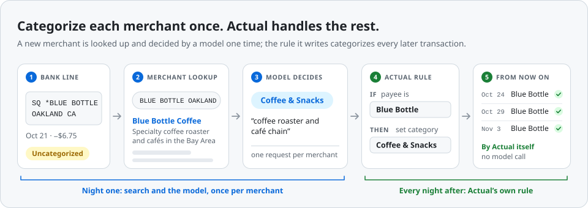
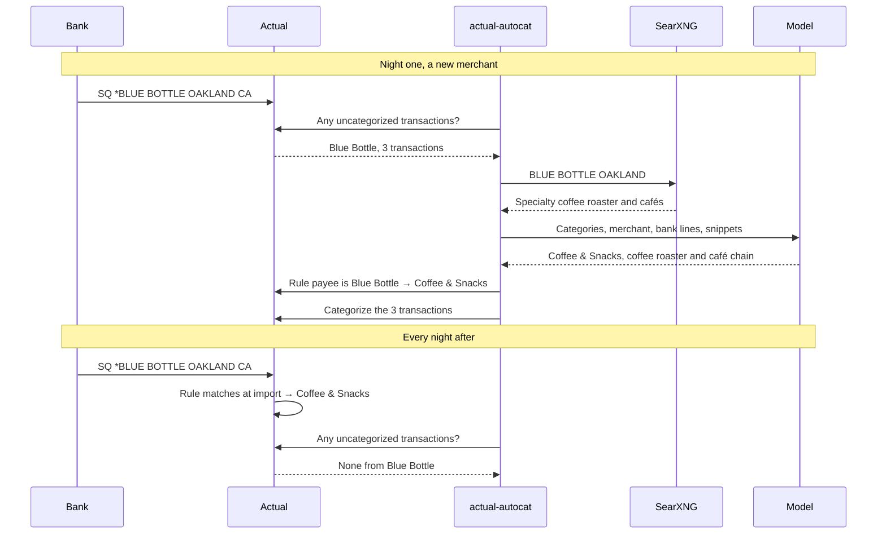
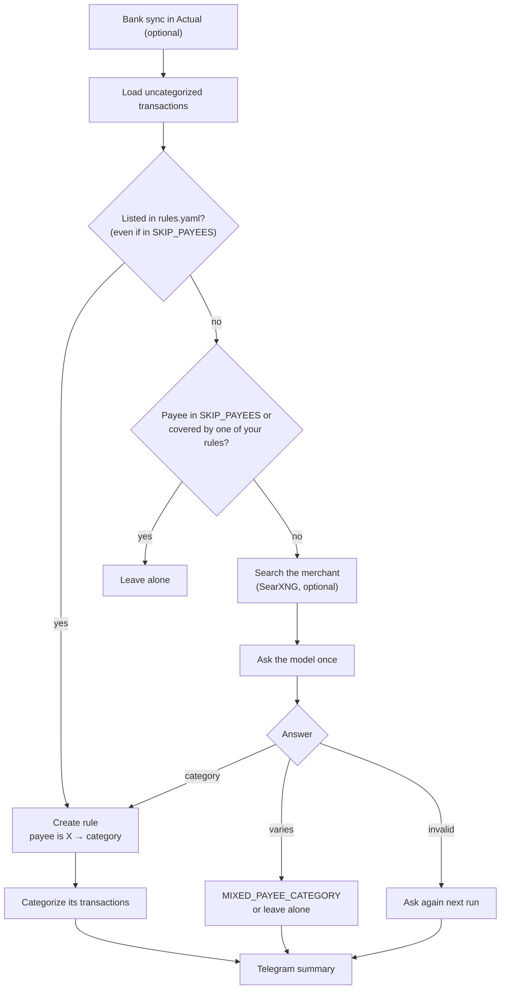
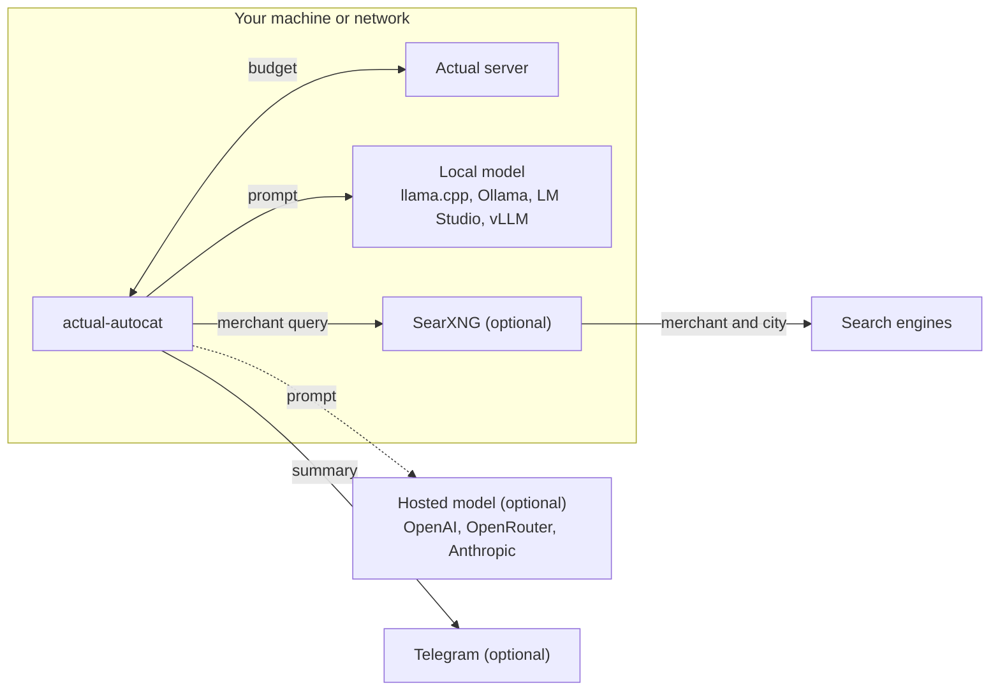

<picture>
  <source media="(prefers-color-scheme: dark)" srcset="docs/images/hero-dark.svg">
  <source media="(prefers-color-scheme: light)" srcset="docs/images/hero-light.svg">
  
</picture>

# actual-autocat

**Categorize each merchant once with an LLM, then let Actual's own rules do the rest.**

[](LICENSE)


actual-autocat is a small Docker container for [Actual Budget](https://actualbudget.org).
Every night it finds merchants that have uncategorized transactions, asks a model
(a local OpenAI-compatible server or Claude) once per merchant which category fits,
optionally helped by a web search through your own [SearXNG](https://docs.searxng.org),
and **creates an Actual rule** for that merchant. From then on Actual categorizes that
merchant by itself when transactions are imported, with no model involved. A short
Telegram message lists every rule it created and why.

## Contents

- [Why once per merchant](#why-once-per-merchant)
- [Night one vs. every night after](#night-one-vs-every-night-after)
- [How a run works](#how-a-run-works)
- [Quick start](#quick-start)
- [Set up with Claude Code](#set-up-with-claude-code)
- [First run: dry run, then live](#first-run-dry-run-then-live)
- [The summary message](#the-summary-message)
- [Configuration](#configuration)
- [Model recipes](#model-recipes)
- [Merchant lookup with SearXNG](#merchant-lookup-with-searxng)
- [Guidance and seed rules](#guidance-and-seed-rules)
- [Fixing or undoing a rule](#fixing-or-undoing-a-rule)
- [Where it runs and what leaves your machine](#where-it-runs-and-what-leaves-your-machine)
- [How well it works](#how-well-it-works)
- [Troubleshooting](#troubleshooting)
- [Limitations](#limitations)
- [Development](#development)

## Why once per merchant

In a real budget a few merchants make up most transactions: the same coffee shop, the
same grocery store, the same transit card, week after week. Asking a model about every
single transaction repeats the same question over and over, costs time (or money), and
can give different answers for the same merchant on different days.

actual-autocat asks **once per merchant** and writes the answer down as an ordinary Actual
rule (`payee is Blue Bottle → set category Coffee & Snacks`). That has a few nice effects:

- **Cheap and fast.** One short prompt per new merchant (about 1,800 tokens with search
  results), which suits small local models. A budget with a few hundred transactions
  usually has far fewer merchants.
- **Consistent.** A merchant always lands in the same category, because Actual applies the
  rule, not a model.
- **Visible and fixable.** Every decision is a rule you can see, edit or delete on Actual's
  Rules page, and every one is listed in the summary with the model's reason.
- **Respectful of your setup.** It never changes rules it didn't create, never touches a
  transaction that already has a category, and skips any merchant one of your own rules
  already covers.

**Compared with [actual-ai](https://github.com/sakowicz/actual-ai):** actual-ai is a
popular, more general tool that sends each uncategorized transaction to a model and sets
its category. It doesn't create rules, so the next transaction from the same merchant goes
to the model again (categorizing through Actual's API also doesn't trigger Actual's own
"learn from my edits" behavior, which only reacts to edits in the UI). actual-autocat does
one narrower thing: it decides once per merchant and writes a rule, so Actual handles that
merchant from then on. If you want per-transaction categorization or its other features,
actual-ai is a good choice.

## Night one vs. every night after

A new merchant goes through search and the model exactly once. After that, its
transactions are categorized by the rule as they are imported, and actual-autocat never
sees them.



## How a run works



In words:

1. Connect to Actual with the official `@actual-app/api` and download the budget. If
   `SYNC_BEFORE_RUN=true`, run bank sync first.
2. Load categories, payees, rules and uncategorized transactions (not transfers, starting
   balances or split parents; open, on-budget accounts only).
3. Create the seed rules from `config/rules.yaml` first (no model involved), each once.
   This includes payees matching `SKIP_PAYEES`; a seed is skipped only when one of your
   rules already covers its payee.
4. Drop payees matching `SKIP_PAYEES`. Skip transactions without a payee, and payees that
   any of your rules with a "set category" action already mentions. Their leftover
   uncategorized transactions are counted as "left for your rules" (Actual's Rules page can
   apply a rule to existing transactions).
5. For every other payee, most transactions first: build a search query from the newest
   raw bank line (`SQ *BLUE BOTTLE OAKLAND CA` → `BLUE BOTTLE OAKLAND`), fetch a few
   SearXNG snippets if configured (cached for 30 days), and ask the model once. The prompt
   has your category list, your guidance, the snippets, the payee name, up to 3 raw bank
   lines, a typical amount and whether it is income or an expense. The model answers with
   a category or `"varies"` (marketplaces, general stores, payment apps, ATMs).
6. Unless in dry run: sync with the server and re-read the rules (if you made a rule for
   that payee while the run was going, it is left alone), create the rule, categorize that
   payee's still-uncategorized transactions (adding `#autocat` to their notes), and append
   a line to `data/rules-created.jsonl`.
7. Sync back to the server and send the summary if anything happened.

Runs never overlap: if a run is still going when the next one is due, the next one is
skipped. If the model fails 3 times in a row (unreachable, timing out), the run
stops and the summary says `model unreachable`. Stopping the container mid-run cancels the
model request in flight; the run finishes the merchant it is writing, saves its state and
closes the budget before exiting (the compose file allows 30 seconds for that).

## Quick start

You need Docker with Compose, an Actual server, and a model: a local OpenAI-compatible
server (llama.cpp, Ollama, LM Studio, vLLM) or an API key for OpenAI, OpenRouter or
Anthropic. There's no published image; you build it from this repo.

```sh
git clone https://github.com/tomvonheill/actual-autocat.git
cd actual-autocat
cp docker-compose.example.yml docker-compose.yml
cp .env.example .env              # then fill it in (see below)
mkdir -p config data

docker compose build
docker compose run --rm autocat check   # tests every connection, changes nothing
docker compose run --rm autocat run     # one run now, in dry run by default
```

In `.env`, set at least `ACTUAL_SERVER_URL`, `ACTUAL_PASSWORD`, `ACTUAL_BUDGET_ID` (Actual
→ Settings → Show advanced settings → Sync ID) and your model. The ready-made blocks in
[`examples/`](examples) cover each provider: paste one in place of the model section.

The container has three commands:

| Command | What it does |
|---|---|
| `docker compose up -d` | Starts the scheduler (the default): runs on `SCHEDULE`, every night at 02:00 by default |
| `docker compose run --rm autocat run` | One run now, honoring `DRY_RUN` |
| `docker compose run --rm autocat check` | Tests the Actual login and budget download, the model (one tiny request), SearXNG (one query) and Telegram (one test message), then prints your category groups and categories and how many transactions are uncategorized. Never prints secrets and changes nothing in Actual |

> **`localhost` inside the container is the container.** If Actual or your model runs on
> the same machine, use `http://host.docker.internal:<port>` (the compose file maps it,
> also on Linux), or the machine's LAN address.

## Set up with Claude Code

If you use [Claude Code](https://claude.com/claude-code), it can walk
you through all of this. Clone the repo, run `claude` in the folder and type:

```
/setup
```

It checks Docker, asks one question at a time about where Actual runs, which model you
use, and whether you want SearXNG and Telegram, then writes `.env` from the matching
example. **It never asks for your passwords or keys:** it leaves those lines for you to
paste into `.env` in your own editor. It then builds the image, runs `check` until
everything passes (explaining any failure in plain words), offers to draft your
`guidance.md` and `rules.yaml`, does a dry run and explains the result. It only switches
to live when you say so. The repo ships no `.claude/settings.json`, so Claude Code asks
before every command as usual.

## First run: dry run, then live

`DRY_RUN=true` is the default. A dry run does everything except write: it asks the model
about each merchant and sends a summary that starts with `DRY RUN:` and says what it
*would* create. Nothing in Actual changes (bank sync is skipped too, since it imports
transactions).

1. Run `docker compose run --rm autocat run` and read the summary (or the log, which has
   one line per merchant: `<payee>: <category> (<seconds>s)`). On a slow model with a big
   backlog, `MAX_PAYEES_PER_RUN=20` keeps the first try short.
2. If some decisions are off, add a line to `config/guidance.md` or an entry to
   `config/rules.yaml` and dry-run again.
3. When you like what you see, set `DRY_RUN=false` in `.env` and start the scheduler:

   ```sh
   docker compose up -d
   docker compose logs -f autocat
   ```

It then runs on `SCHEDULE` (cron syntax, in `TZ`). Set `RUN_ON_START=true` to also run
once whenever the container starts. An empty `SCHEDULE` runs once and exits: only use that
with `docker compose run` or your own host cron, never with `docker compose up -d` (with
`restart: unless-stopped`, Docker would restart it right away, over and over).

## The summary message

After each run that did something (or failed), you get one plain-text Telegram message:

<picture>
  <source media="(prefers-color-scheme: dark)" srcset="docs/images/summary-dark.svg">
  <source media="(prefers-color-scheme: light)" srcset="docs/images/summary-light.svg">
  
</picture>

- Each line is one new rule: payee → category, the model's one-line reason, and how many
  transactions it categorized. `from rules.yaml` marks a seed rule; `varies, …` marks a
  merchant sent to `MIXED_PAYEE_CATEGORY`.
- **Not decided**: the model's answer was invalid or the request failed. That merchant is
  asked again next run.
- **Varies, left alone**: the model said the merchant has no single category and
  `MIXED_PAYEE_CATEGORY` is empty.
- **Left for your rules**: uncategorized transactions of payees your own rules cover
  (usually older than the rule). Apply the rule to them from Actual's Rules page.
- A failed run (Actual or the model unreachable) starts with `Budget autocat failed:` and
  the error, followed by the usual lines for whatever it did before failing (rules it
  already created, with their reasons).

Without Telegram, the same information is in the container log.

## Configuration

Everything is set with environment variables in `.env`. [`.env.example`](.env.example)
lists all of them with comments. Required ones fail at startup with a clear message.

| Variable | Default | Meaning |
|---|---|---|
| `ACTUAL_SERVER_URL` | required | Actual server URL as reachable from the container |
| `ACTUAL_PASSWORD` | required | Actual server password |
| `ACTUAL_BUDGET_ID` | required | The budget's Sync ID (Settings → Show advanced settings) |
| `ACTUAL_ENCRYPTION_PASSWORD` | empty | Only for end-to-end encrypted budgets |
| `LLM_PROVIDER` | `openai` | `openai` (any OpenAI-compatible server) or `anthropic` (Claude) |
| `LLM_BASE_URL` | required for `openai` | e.g. `http://host.docker.internal:8080/v1`, `https://api.openai.com/v1`. Must be empty for `anthropic` |
| `LLM_API_KEY` | empty | Required for hosted providers |
| `LLM_MODEL` | required | Model name as the server expects it |
| `LLM_JSON_SCHEMA` | `true` | Send a JSON schema with OpenAI-compatible requests; `false` if your server rejects it |
| `LLM_TIMEOUT_SECONDS` | `300` | Per model request, at least 1 |
| `SEARXNG_URL` | empty | SearXNG base URL; empty turns search off. JSON output must be enabled (see below) |
| `SEARCH_RESULTS` | `3` | Search results per merchant |
| `SCHEDULE` | `0 2 * * *` | Cron expression; empty = run once and exit (only for `docker compose run` or host cron, not `up -d`) |
| `TZ` | `UTC` | Time zone for the schedule |
| `RUN_ON_START` | `false` | Also run once when the container starts |
| `DRY_RUN` | `true` | Report only; nothing in Actual changes |
| `SYNC_BEFORE_RUN` | `true` | Run bank sync before categorizing (never in dry run) |
| `SKIP_PAYEES` | empty | Regular expression of payee names to leave alone, matched case-insensitively anywhere in the name |
| `MAX_PAYEES_PER_RUN` | `0` (no limit) | Ask about at most this many merchants per run, most transactions first |
| `MIXED_PAYEE_CATEGORY` | empty | Category name for merchants with no single category (e.g. `Miscellaneous`); a rule is created to it. Empty = leave them uncategorized |
| `NOTES_TAG` | `#autocat` | Added to the notes of transactions it categorizes; set it empty to turn off |
| `TELEGRAM_BOT_TOKEN`, `TELEGRAM_CHAT_ID` | empty | Both set = send summaries |
| `LOG_LEVEL` | `info` | `debug` also logs every prompt and model reply |
| `CONFIG_DIR`, `DATA_DIR` | `/config`, `/data` | Only for running outside Docker |

**Skipping payees.** `SKIP_PAYEES` is a regular expression tested against each payee name,
ignoring case. For example, to leave card payments and transfers alone:

```sh
SKIP_PAYEES=^(payment|transfer|autopay)|credit card
```

**Files.** The compose file mounts two folders:

| Path in the container | On your machine | What's in it |
|---|---|---|
| `/config/guidance.md` | `config/guidance.md` | Optional: how your budget uses its categories ([below](#guidance-and-seed-rules)) |
| `/config/rules.yaml` | `config/rules.yaml` | Optional: seed rules |
| `/data/rules-created.jsonl` | `data/rules-created.jsonl` | Audit log, one JSON line per rule created: `at`, `payee`, `category`, `reason`, `source` (`model`, `seed` or `mixed`), `ruleId`, `txnCount` |
| `/data/state.json` | `data/state.json` | Seeds already created and "varies" payees not to ask about again |
| `/data/search-cache.json` | `data/search-cache.json` | SearXNG results, kept for 30 days |
| `/data/actual-cache/` | `data/actual-cache/` | The downloaded budget |

`config/` is mounted read-only. The container runs as UID 1000, so `data/` must be
writable by that user.

**Actual API version.** `@actual-app/api` must match your Actual server's version. The
image uses `26.10.0`; build with your server's version if it differs:

```sh
docker compose build --build-arg ACTUAL_API_VERSION=<your server version>
```

## Model recipes

Each file in [`examples/`](examples) is a complete, commented model block to paste into
`.env`:

| Setup | File | Key settings |
|---|---|---|
| llama.cpp (`llama-server`) | [`llamacpp.env`](examples/llamacpp.env) | `LLM_BASE_URL=http://host.docker.internal:8080/v1` |
| Ollama | [`ollama.env`](examples/ollama.env) | `LLM_BASE_URL=http://host.docker.internal:11434/v1` |
| LM Studio | [`lmstudio.env`](examples/lmstudio.env) | `LLM_BASE_URL=http://host.docker.internal:1234/v1` |
| OpenAI | [`openai.env`](examples/openai.env) | `LLM_BASE_URL=https://api.openai.com/v1`, `LLM_API_KEY` |
| OpenRouter | [`openrouter.env`](examples/openrouter.env) | `LLM_BASE_URL=https://openrouter.ai/api/v1`, `LLM_API_KEY` |
| Claude | [`claude.env`](examples/claude.env) | `LLM_PROVIDER=anthropic`, `LLM_MODEL=claude-opus-5-5`, `LLM_API_KEY` |

Notes:

- **OpenAI-compatible servers** get a plain `POST {LLM_BASE_URL}/chat/completions` at
  temperature 0, with a JSON schema (`response_format`) whose category is limited to your
  category IDs. llama.cpp, OpenAI, vLLM, LM Studio and recent Ollama honor it. If yours
  rejects it, set `LLM_JSON_SCHEMA=false` and the reply is parsed leniently (the first
  JSON object in the text). vLLM works the same way: point `LLM_BASE_URL` at its `/v1`.
- **Thinking models** (e.g. Qwen in thinking mode) are fine: only the final answer is read.
- **Claude** uses Anthropic's official SDK with structured output, so the reply is always
  valid JSON, at low effort. `claude-opus-5-5` is the example; cheaper Claude models work
  too, just change `LLM_MODEL`.
- Small local models do well here: one short prompt per merchant, no tool calling, no
  long context.

## Merchant lookup with SearXNG

Bank lines are often cryptic. With `SEARXNG_URL` set, actual-autocat cleans up the newest
bank line into a search query (dropping card-processor prefixes like `SQ *` and `TST*`,
store numbers, ACH boilerplate and trailing state codes), searches your SearXNG instance,
and puts the first `SEARCH_RESULTS` snippets into the prompt, with a note that they may be
about a different business. The model never calls tools; search always runs first.
Results are cached in `data/search-cache.json` for 30 days.

SearXNG's JSON output is off by default. Turn it on in its `settings.yml` and restart it:

```yaml
search:
  formats:
    - html
    - json
```

Without it, SearXNG answers with 403 or an HTML page, and `check` says so.

**Keeping it private.** Run your own instance (the
[SearXNG Docker setup](https://docs.searxng.org/admin/installation-docker.html) is the
easiest) rather than a public one, and keep it on your own network. Your instance still
forwards each query to the search engines it is configured to use, so those engines see the
merchant name and city from your bank line, nothing else. See
[`examples/searxng.env`](examples/searxng.env).

## Guidance and seed rules

**`config/guidance.md`** is free text added to every prompt. It's the best way to improve
results: tell the model how *your* budget uses its categories, one line per category. See
[`examples/config/guidance.md`](examples/config/guidance.md):

```
How this budget uses its categories:
* Groceries: supermarkets, grocery stores, farmers markets, butchers, bulk and warehouse food shopping.
* Restaurants: sit-down and fast-food meals, takeout, food delivery apps, bars and pubs.
* Coffee: coffee shops, cafés, bakeries, tea and juice bars.
...
```

Use your own category names exactly as they appear in Actual (`check` prints them).

**`config/rules.yaml`** holds merchants you already know, as `payee name: category name`.
They become rules on the next run, before the model is asked about anything, and show up in
the summary as `from rules.yaml`. See
[`examples/config/rules.yaml`](examples/config/rules.yaml):

```yaml
Metro Transit: Transport
Northwind Energy: Utilities
```

Names are matched case-insensitively. A payee that doesn't exist yet is tried again on later
runs; a category name that doesn't exist is reported in the summary (and by `check`). Seeds
are created first, even for payees matching `SKIP_PAYEES`. Each seed is created once: if you
delete that rule in Actual, it is not recreated from `rules.yaml`, but the model then
decides that payee on the next run like any other. Add it to `SKIP_PAYEES` to leave it
alone.

## Fixing or undoing a rule

Every rule created is an ordinary Actual rule, listed in the summary and in
`data/rules-created.jsonl` (with its `ruleId`, so you can tell exactly which ones the tool
made).

- **Wrong category:** open Actual → Rules, find the rule (`payee is <name>`), and change its
  category. Your edited rule is now yours; actual-autocat never changes it. Fix the
  transactions it already categorized in Actual (search notes for `#autocat` to find them).
- **Don't want the rule at all:** delete it in Actual → Rules. Transactions it categorized
  keep their category. Once the rule is gone, seed or model-made, that merchant is like any
  new one: if it has uncategorized transactions, the model decides it on the next run and
  may create a rule again (a seed is not recreated from `rules.yaml`, but the model can
  still decide it). Add it to `SKIP_PAYEES` to leave it alone for good.
- **"Varies, left alone" merchants** are remembered in `data/state.json` (by payee ID) when
  `MIXED_PAYEE_CATEGORY` is empty, and not asked about again. Remove an ID from `varies`
  there to have it reconsidered, or create a rule for it yourself.

## Where it runs and what leaves your machine



- **Local model and your own SearXNG:** nothing leaves your network except the search
  queries SearXNG forwards to search engines (the merchant name and city from a bank line).
- **Hosted model** (OpenAI, OpenRouter, Anthropic): for each merchant, the prompt goes to
  that provider. It contains your category names, your `guidance.md`, the merchant name,
  up to 3 raw bank lines, a typical amount, and any search snippets. No account names,
  balances, dates or other transactions.
- **Telegram** receives the summary: merchant and category names, the model's reasons,
  and transaction counts.
- Passwords and API keys are never logged or printed, including by `check`.

## How well it works

On the author's own budget (56 hand-labelled transactions), with Qwen3.6-35B-A3B running on
a mini-PC's integrated GPU:

| Setup | Correct |
|---|---|
| Generic prompt | 75% |
| With budget-specific guidance | 86% |
| Guidance plus SearXNG snippets | 91% |

Each merchant took about 6–7 seconds. That's one person's budget, not a benchmark; your
results depend on your categories, your guidance and your model. The dry run shows you
before anything changes.

## Troubleshooting

Start with `docker compose run --rm autocat check`: it tests each connection and says what
failed.

- **Login or budget download fails with errors about versions, migrations or sync.** The
  `@actual-app/api` version doesn't match your server. Rebuild with
  `--build-arg ACTUAL_API_VERSION=<your server version>` (see
  [Configuration](#configuration)). This is the most common problem.
- **Connection refused / can't reach Actual or the model.** `localhost` inside the
  container is the container. Use `host.docker.internal`, a LAN address, or a Docker
  service name, and make sure the server listens on more than `127.0.0.1` (llama.cpp:
  `--host 0.0.0.0`; Ollama: `OLLAMA_HOST=0.0.0.0`).
- **`network-failure` right after start-up.** Autocat retries the Actual connection for about
  90 seconds while the server starts (for example with `RUN_ON_START=true` in a compose
  stack); if it still fails, the server is down or the URL is wrong.
- **Encrypted budget.** Set `ACTUAL_ENCRYPTION_PASSWORD`.
- **The model returns invalid JSON or HTTP 400.** Your server may not support JSON
  schemas: set `LLM_JSON_SCHEMA=false`. Check `LLM_MODEL` is a name the server knows.
  Requests use temperature 0; a hosted model that only accepts its default temperature
  (some reasoning models) returns 400, so pick another model. Merchants with an invalid
  answer are listed as "Not decided" and asked again next run; `LOG_LEVEL=debug` shows the
  prompts and replies.
- **SearXNG returns 403 or HTML.** Enable JSON output (`search.formats: [html, json]` in
  `settings.yml`) and restart SearXNG.
- **Model requests time out.** Raise `LLM_TIMEOUT_SECONDS`, or use `MAX_PAYEES_PER_RUN` to
  spread a big backlog over several nights. A timed-out request is not retried (network
  errors, HTTP 429 and 5xx are, twice); after 3 failed requests in a row the run stops.
- **`EACCES` or permission denied under `/data`.** The container runs as UID 1000; make
  `data/` writable for it: `sudo chown 1000:1000 data`.
- **No Telegram message.** Both `TELEGRAM_BOT_TOKEN` and `TELEGRAM_CHAT_ID` must be set,
  and you must have sent the bot a message first. Runs that did nothing send nothing.
- **`MIXED_PAYEE_CATEGORY ... is not the name of a visible category`.** Use a category name
  exactly as it appears in Actual (case doesn't matter), and not a hidden one.

## Limitations

- Rules match on the payee (`payee is <name>`). If your bank imports the same merchant
  under several payee names, each gets its own decision and rule.
- One category per merchant. Merchants that sell everything are "varies": sent to
  `MIXED_PAYEE_CATEGORY` or left for you.
- It only categorizes. No transfers, splits, budgeting, payee renaming or credit-card
  payment handling.
- Decisions aren't revisited: once a rule exists, it's yours to change.
- The model can be wrong. Every rule appears in the summary with its reason, so mistakes
  are visible and quick to fix in Actual.
- No published container image yet; build it from this repo.
- Notifications are Telegram only for now.

## Development

Plain JavaScript (ES modules) on Node 22, no build step.

```sh
npm install
node --test
```

The design is in [`docs/design.md`](docs/design.md). Tests use made-up merchants only.

## License

[MIT](LICENSE)
